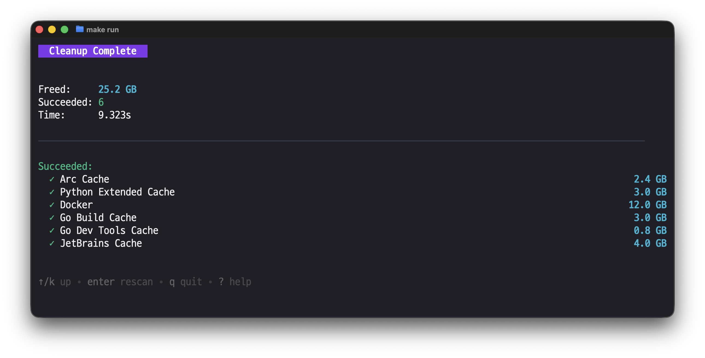
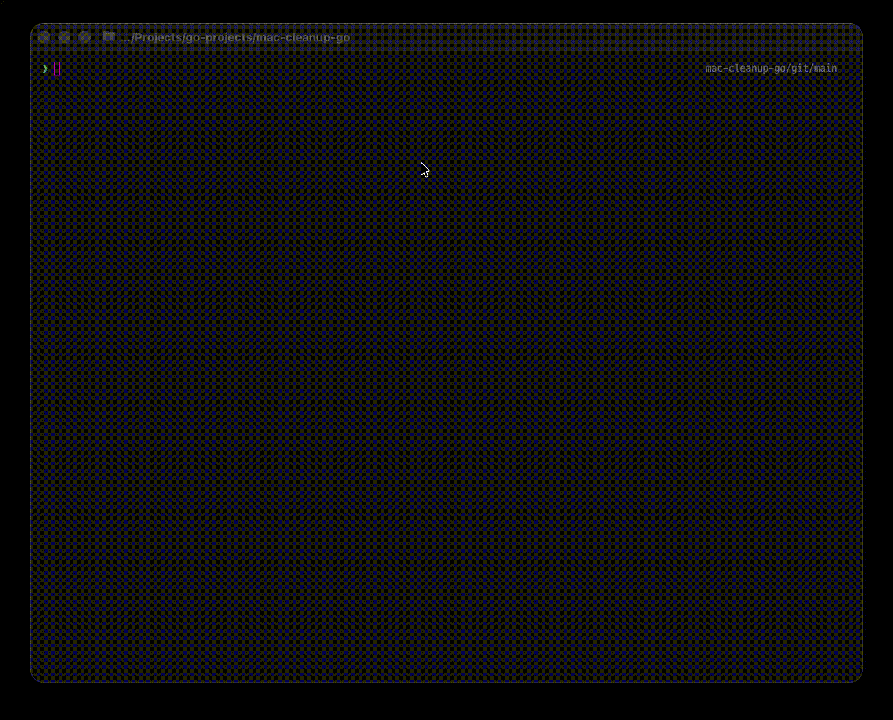

<div align="center">
  <h1>mac-cleanup-go</h1>
  <p>Preview-first TUI for cleaning macOS caches, logs, and temporary files.</p>
</div>

<p align="center">
  <a href="https://github.com/2ykwang/mac-cleanup-go/releases"></a>
  <a href="https://pkg.go.dev/github.com/2ykwang/mac-cleanup-go"></a>
  <a href="https://goreportcard.com/report/github.com/2ykwang/mac-cleanup-go"></a>
  <a href="https://github.com/2ykwang/mac-cleanup-go/actions/workflows/test.yml"></a>
  <a href="https://codecov.io/gh/2ykwang/mac-cleanup-go"></a>
  <a href="https://golangci-lint.run/"></a>
</p>

<p align="center">
  <a href="README.md">English</a> | <a href="assets/README_KO.md">한국어</a>
</p>

## Overview

- Select items that take up space and delete them yourself.
- By default, items go to Trash; only the Trash category empties it permanently.
- Risky categories are unselected by default; even when selected, items are auto-excluded. (Include them in Preview to delete.)
- Manual categories show guides only.
- Scope: caches/logs/temp and selected app data (no system optimization or uninstaller).




## Quick Start

**1) Install**

```bash
brew install mac-cleanup-go
```

Or download the archive from [GitHub Releases](https://github.com/2ykwang/mac-cleanup-go/releases).

**2) Optional: Full Disk Access (needed for Trash/restricted locations)**
System Settings -> Privacy & Security -> Full Disk Access -> add Terminal

**3) Run**

```bash
mac-cleanup
```

Tip: Use Enter to preview, then y to proceed with deletion. Press ? to see key bindings.



- Update: `brew upgrade mac-cleanup-go` or `mac-cleanup update`.
- Uninstall: `brew uninstall mac-cleanup-go`.
- Debug: `mac-cleanup --debug` saves log to `~/.config/mac-cleanup-go/debug.log`.

<details>
<summary><strong>Key bindings</strong></summary>

List view:

- `Up`/`Down` or `k`/`j`: move
- `Space`: select category
- `a`: select all, `d`: deselect all
- `Enter` or `p`: preview selection
- `?`: help, `q`: quit

Preview view:

- `Up`/`Down` or `k`/`j`: move
- `h`/`l`: previous/next category
- `Space`: toggle exclude
- `Enter`: drill into directory
- `/`: search, `s`: sort, `o`: open in Finder
- `a`: include all, `d`: exclude all
- `y`: delete (confirm), `esc`: back

Confirm view:

- `y` or `Enter`: confirm
- `n` or `esc`: cancel

</details>

## CLI mode

Scan and clean without the TUI. Every command takes target IDs; `--json` gives machine-readable output.

```bash
mac-cleanup scan                            # Sizes per target (read-only)
mac-cleanup scan system-cache --items       # Largest items in one target
mac-cleanup clean npm go-build --dry-run    # Preview exactly what will be cleaned
mac-cleanup clean npm go-build              # Clean (asks to confirm; --yes skips)
```

- `mac-cleanup targets` lists every target ID without scanning.
- `mac-cleanup select` saves targets for `mac-cleanup clean --selected`.
- Risky targets are only cleaned item by item with `--item <path>`.
- Targets with a side effect (`homebrew` runs `brew cleanup`) are cleaned whole; `--item` is rejected for them.
- Exit codes: `0` ok, `1` error, `2` usage error or confirmation needed, `3` some items failed.
- Run `mac-cleanup help <command>` for all flags.

For command-line cleanup, see the examples below.

<details>
<summary><strong>Example output</strong></summary>

**1) Select targets**

```
$ mac-cleanup select

Select cleanup targets                  ● safe  ○ moderate
─────────────────────────────────────────────────────────
        Name                                      Size
  [ ] ● Trash                                      0 B
  [✓] ○ App Caches                              3.2 GB
  [✓] ○ System Logs                           259.7 MB
▸ [✓] ● Go Build Cache                        845.0 MB
  [✓] ○ Docker                                  2.8 GB
  [✓] ● Homebrew Cache                          1.5 GB
  [ ] ● Chrome Cache                               0 B
─────────────────────────────────────────────────────────
Selected: 5
↑/↓ Move  space Select  s Save  ? Help  q Cancel
```

**2) Preview / Clean**

```
$ mac-cleanup clean --selected --dry-run

Dry Run Report
--------------
Mode: Dry Run

Summary                             Highlights
Freed (dry-run): 8.6 GB             1. App Caches - 3.2 GB (523 items)
                                    2. Docker - 2.8 GB (12 items)
                                    3. Homebrew Cache - 1.5 GB (34 items)

Details
STATUS  CATEGORY              ITEMS        SIZE
OK      App Caches              523      3.2 GB
OK      Docker                   12      2.8 GB
OK      Homebrew Cache           34      1.5 GB
OK      Go Build Cache           89    845.0 MB
OK      System Logs              67    259.7 MB
```

</details>

## Use with AI agents

mac-cleanup ships an [Agent Skill](https://agentskills.io) that teaches coding agents (Claude Code, Codex, Copilot, ...) the scan → preview → approve → clean workflow. Agents can read it with `mac-cleanup skill` without installing it.

To install the latest skill from the repository:

```bash
npx skills add https://github.com/2ykwang/mac-cleanup-go/tree/main/internal/cli/skills/mac-cleanup --skill mac-cleanup -g
```

Or save the copy bundled with your installed version:

```bash
mkdir -p ~/.claude/skills/mac-cleanup
mac-cleanup skill > ~/.claude/skills/mac-cleanup/SKILL.md
```

Agents use `--json` output and never clean without `--yes`, which the skill only allows after you approve a dry run.

Try prompts like:

> Find what's using disk space in my development caches. Show me the largest cleanup candidates and what each one contains.

> Clean my npm and Go build caches.

> Find and clean up caches on my Mac.

Installing the skill makes it available to compatible agents. Otherwise, mention `mac-cleanup` and ask the agent to read `mac-cleanup skill`.

## How it works & safety

- Scans known cache/log/temp paths across apps and tools in parallel.
- Lets you preview items and exclude what you want to keep.
- Labels targets by impact level (safe, moderate, risky, manual).
- SIP-protected paths are excluded from scan/cleanup.
- Built-in scans for Homebrew, Docker, old downloads, stale project build caches, and old Claude Code/Codex releases (command output, last-modified time, or the active release).

## Impact levels

- safe: auto-regenerated caches/logs.
- moderate: may require re-download or re-login.
- risky: user data possible; items start excluded.
- manual: no automatic deletion; shows an app guide only.

## Targets (as of v1.7.0)

- Total targets: 202.
- Groups: System 14, Browsers 15, Development 71, Applications 97, Storage 5.
- Cleanup methods: trash 192, permanent 2, builtin 6, manual 2.
- Builtins: homebrew, docker, old-downloads, project-cache, claude-code-versions, codex-daemon-releases (built-in scanners using command output, last-modified time, or the active release).
- Manual: telegram, kakaotalk (no automatic deletion; surfaces large data like chat caches).
- Counts are release-based and may change over time.

## Alternatives

- [mac-cleanup-py](https://github.com/mac-cleanup/mac-cleanup-py) - Python cleanup script for macOS
- [Mole](https://github.com/tw93/Mole) - Deep clean and optimize your Mac

## License

MIT
