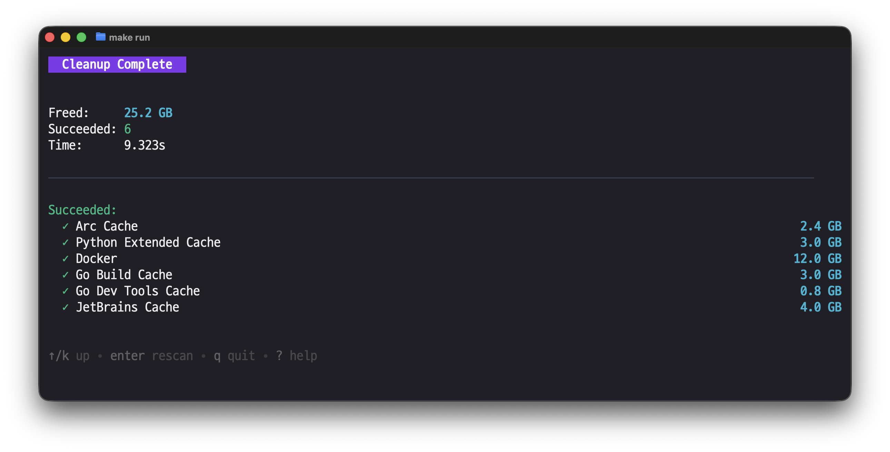
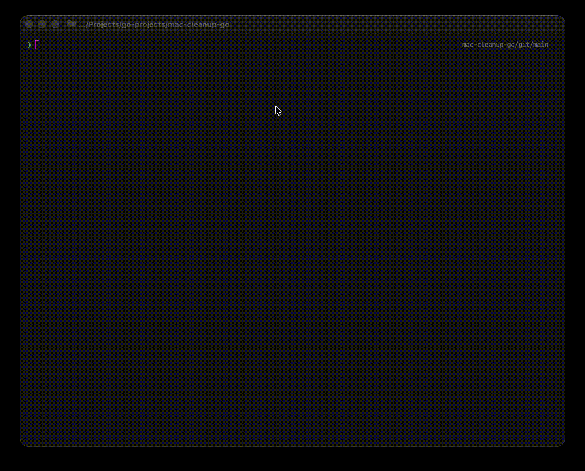

<div align="center">
  <h1>mac-cleanup-go</h1>
  <p>TUI 또는 CLI로 삭제할 항목을 선택하여 macOS 캐시, 로그, 임시 파일을 정리합니다.</p>
</div>

<p align="center">
  <a href="https://github.com/2ykwang/mac-cleanup-go/releases"></a>
  <a href="https://pkg.go.dev/github.com/2ykwang/mac-cleanup-go"></a>
  <a href="https://goreportcard.com/report/github.com/2ykwang/mac-cleanup-go"></a>
  <a href="https://github.com/2ykwang/mac-cleanup-go/actions/workflows/test.yml"></a>
  <a href="https://codecov.io/gh/2ykwang/mac-cleanup-go"></a>
  <a href="https://golangci-lint.run/"></a>
</p>

<p align="center">
  <a href="../README.md">English</a> | <a href="README_KO.md">한국어</a>
</p>

## 개요

- 용량을 불필요하게 차지하는 항목을 직접 선택하여 삭제할 수 있습니다.
- 기본은 휴지통으로 이동하고, '휴지통'과 'Shell History Residue' 카테고리만 영구 삭제합니다.
- risky 카테고리는 기본 미선택이며, 선택해도 항목은 자동 제외됩니다. (삭제하려면 미리보기에서 포함해야 합니다.)
- manual 카테고리는 삭제 가이드만 표시합니다.
- 작업 범위: 캐시/로그/임시 파일과 일부 앱 데이터. 시스템 최적화/앱 제거는 하지 않습니다.



## 빠른 시작

**1) 설치**

```bash
brew install mac-cleanup-go
```

또는 [GitHub Releases](https://github.com/2ykwang/mac-cleanup-go/releases)에서 내려받아 실행하세요.

**2) (선택) 전체 디스크 접근 (휴지통/제한 경로 정리에 필요)**
시스템 설정 -> 개인정보 보호 및 보안 -> 전체 디스크 접근 -> Terminal 추가

**3) 실행**

```bash
mac-cleanup
```

팁: Enter로 미리보기, y로 삭제 진행. 키 바인딩은 ? 키로 확인하세요.



- 업데이트: `brew upgrade mac-cleanup-go` 또는 `mac-cleanup update`.
- 삭제: `brew uninstall mac-cleanup-go`.
- 디버그: `mac-cleanup --debug`로 로그 저장 (`~/.config/mac-cleanup-go/debug.log`).

<details>
<summary><strong>키 바인딩</strong></summary>

목록 화면:

- `Up`/`Down` 또는 `k`/`j`: 이동
- `Space`: 카테고리 선택
- `a`: 전체 선택, `d`: 전체 해제
- `Enter` 또는 `p`: 미리보기
- `?`: 도움말, `q`: 종료

미리보기 화면:

- `Up`/`Down` 또는 `k`/`j`: 이동
- `h`/`l`: 이전/다음 카테고리
- `Space`: 제외/포함 전환
- `Enter`: 하위 디렉터리로 이동
- `/`: 검색, `s`: 정렬, `o`: Finder 열기
- `a`: 전체 포함, `d`: 전체 제외
- `y`: 삭제(확인 포함), `esc`: 뒤로

확인 화면:

- `y` 또는 `Enter`: 확인
- `n` 또는 `esc`: 취소

</details>

## CLI 모드

TUI 없이 스캔하고 정리합니다. `targets`, `scan`, `clean`은 대상 ID를 받고, `--json`을 붙이면 에이전트나 스크립트가 처리하기 쉬운 JSON으로 출력합니다.

```bash
mac-cleanup scan                            # 대상별 용량 (읽기 전용)
mac-cleanup scan system-cache --items       # 한 대상의 큰 항목 보기
mac-cleanup clean npm go-build --dry-run    # 정리될 내용을 미리 확인
mac-cleanup clean npm go-build              # 정리 실행 (확인 후 진행, --yes로 생략)
```

- `mac-cleanup targets`는 스캔 없이 전체 대상 ID를 보여줍니다.
- `mac-cleanup select`로 저장한 대상은 `mac-cleanup clean --selected`로 정리합니다.
- 위험(risky) 대상은 `--item <path>`로 항목을 지정해야만 정리됩니다.
- 부수 효과가 있는 대상(`brew cleanup`을 실행하는 `homebrew`)은 통째로만 정리되며 `--item`을 지정할 수 없습니다.
- 종료 코드: `0` 성공, `1` 오류, `2` 사용법 오류 또는 확인 필요, `3` 일부 항목 실패.
- 전체 플래그는 `mac-cleanup help <command>`로 확인하세요.

<details>
<summary><strong>실행 예시</strong></summary>

**1) 대상 선택**

```
$ mac-cleanup select

Select cleanup targets                  ● safe  ○ moderate
─────────────────────────────────────────────────────────
        Name                                      Size
  [ ] ● Trash                                      0 B
  [✓] ○ App Caches                              3.2 GB
  [✓] ○ System Logs                           259.7 MB
▸ [✓] ● Go Build Cache                        845.0 MB
  [✓] ○ Docker                                  2.8 GB
  [✓] ● Homebrew Cache                          1.5 GB
  [ ] ● Chrome Cache                               0 B
─────────────────────────────────────────────────────────
Selected: 5
↑/↓ Move  space Select  s Save  ? Help  q Cancel
```

**2) 미리보기 / 정리**

```
$ mac-cleanup clean --selected --dry-run

Dry Run Report
--------------
Mode: Dry Run

Summary                             Highlights
Freed (dry-run): 8.6 GB             1. App Caches - 3.2 GB (523 items)
                                    2. Docker - 2.8 GB (12 items)
                                    3. Homebrew Cache - 1.5 GB (34 items)

Details
STATUS  CATEGORY              ITEMS        SIZE
OK      App Caches              523      3.2 GB
OK      Docker                   12      2.8 GB
OK      Homebrew Cache           34      1.5 GB
OK      Go Build Cache           89    845.0 MB
OK      System Logs              67    259.7 MB
```

</details>

## AI 에이전트와 함께 쓰기

mac-cleanup은 코딩 에이전트(Claude Code, Codex, Copilot 등)에게 스캔 → 미리보기 → 승인 → 정리 흐름을 알려주는 [Agent Skill](https://agentskills.io)을 제공합니다. 설치하지 않아도 에이전트가 `mac-cleanup skill`로 읽을 수 있습니다.

저장소의 최신 스킬을 설치하려면:

```bash
npx skills add 2ykwang/mac-cleanup-go --skill mac-cleanup -g
```

또는 설치한 바이너리에 포함된 스킬을 파일로 저장해도 됩니다.

```bash
mkdir -p ~/.claude/skills/mac-cleanup
mac-cleanup skill > ~/.claude/skills/mac-cleanup/SKILL.md
```

에이전트는 `--json` 출력을 사용하며, 사용자가 미리보기를 승인하기 전에는 `--yes`로 정리하지 않습니다.

다음과 같이 요청해 보세요.

> 개발 캐시가 디스크를 얼마나 쓰는지 확인하고, 정리 후보 중 큰 항목과 그 안의 내용을 보여줘.

> npm 캐시와 Go 빌드 캐시를 정리해 줘.

> 맥에서 정리할 수 있는 캐시를 찾아서 정리해 줘.

## 작동 방식 및 안전 정책

- 앱/도구별 알려진 캐시, 로그, 임시 경로를 병렬로 스캔합니다.
- 삭제 전 미리보기에서 항목을 제외할 수 있습니다.
- 영향도 라벨(safe, moderate, risky, manual)을 표시합니다.
- SIP 보호 경로는 스캔/정리 대상에서 제외됩니다.
- Homebrew, Docker, 오래된 다운로드 파일, 프로젝트 캐시 후보, Claude Code/Codex 지난 릴리스에 대한 전용 스캐너가 있습니다. 이 스캐너는 고정 경로 대신 명령 출력, 마지막 수정 시각, 현재 사용 중인 릴리스를 기준으로 항목을 찾습니다.

`project-cache`는 의존성과 빌드 디렉터리 이름, 부모 프로젝트의 marker 파일이 일치하고, 내부 파일 중 가장 최신 수정 시각이 7일보다 오래된 항목을 제안합니다. 의존성을 읽거나 실행해도 파일이 수정되지 않을 수 있어 현재 작업 중인 `.venv`, `node_modules`도 후보에 포함될 수 있습니다. **오래됐다는 사실이 프로젝트를 사용하지 않는다는 증거는 아닙니다.** `mac-cleanup scan project-cache --items`로 후보를 확인하세요.

## 영향도 분류 기준

- safe: 자동 재생성되는 캐시/로그.
- moderate: 재다운로드 또는 재로그인이 필요할 수 있음.
- risky: 사용자 데이터가 포함될 수 있어 항목이 기본으로 제외됨.
- manual: 자동 삭제 없이 앱 가이드만 표시.

## 대상 (v1.7.0 기준)

- 전체 대상: 202개.
- 그룹: System 14, Browsers 15, Development 71, Applications 97, Storage 5.
- 처리 방법: trash 192, permanent 2, builtin 6, manual 2.
- builtin: homebrew, docker, old-downloads, project-cache, claude-code-versions, codex-daemon-releases.
- manual: telegram, kakaotalk (자동으로 삭제하지 않고, 채팅 데이터처럼 용량이 큰 항목을 안내만 함).
- 수치는 릴리스 기준이며 변동될 수 있습니다.

## 대안 오픈소스

- [mac-cleanup-py](https://github.com/mac-cleanup/mac-cleanup-py) - Python cleanup script for macOS
- [Mole](https://github.com/tw93/Mole) - Deep clean and optimize your Mac

## License

MIT
